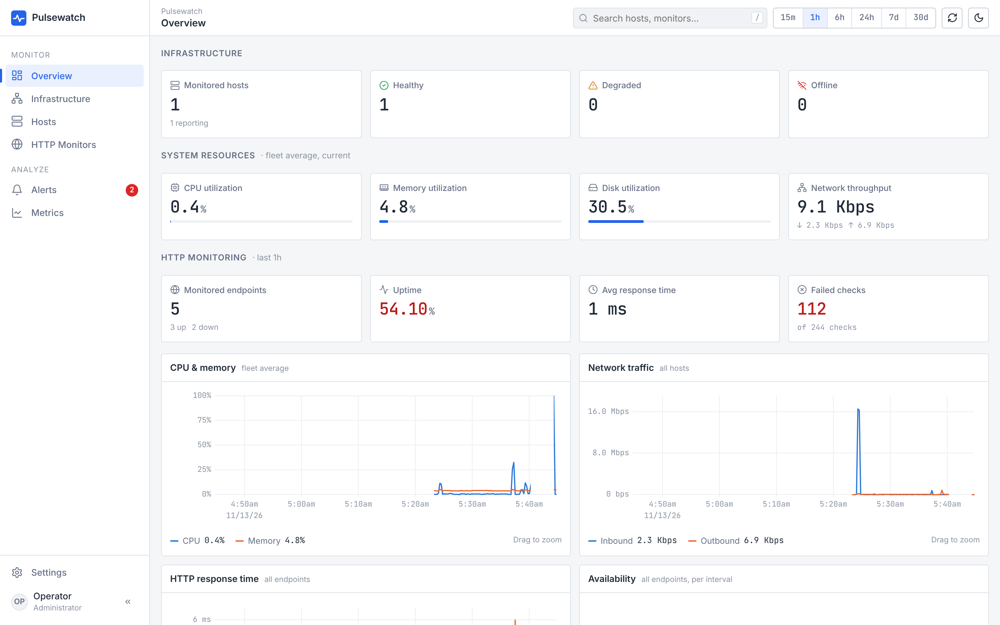
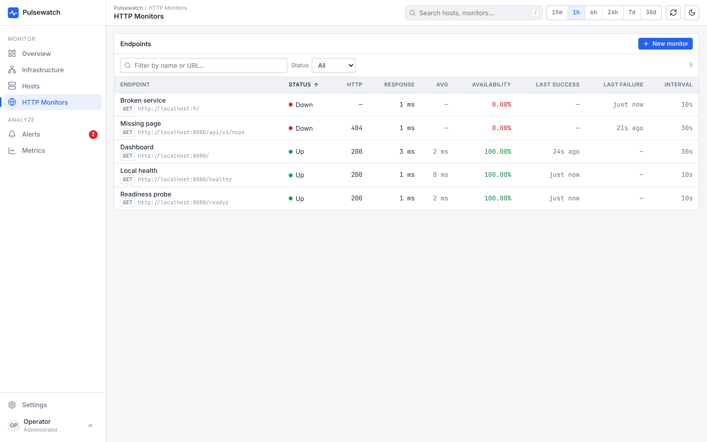
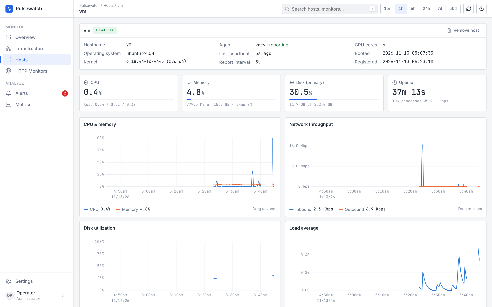
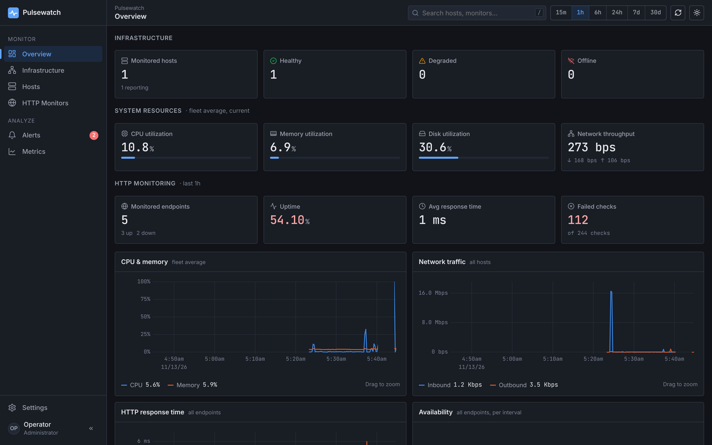

# Pulsewatch

Pulsewatch is a lightweight infrastructure monitoring platform. It monitors Linux hosts (CPU, memory, disk, network, uptime, processes), checks HTTP endpoints, keeps history in PostgreSQL, raises deduplicated alerts with recovery notifications to webhooks, and ships a dense, information-first dashboard.

* **Backend:** Go 1.26, standard-library HTTP routing, `pgx` for PostgreSQL, `gopsutil` for system metrics, `log/slog` for structured logs.
* **Frontend:** React 18 + TypeScript, Vite, TanStack Query, uPlot for charts. Light theme by default, optional dark theme.
* **Deployment:** a single `docker compose up` brings up PostgreSQL, the server and an agent that monitors the Docker host.



| HTTP monitors | Host detail | Dark theme |
|---|---|---|
|  |  |  |

---

## Quick start (one shot)

```bash
docker compose up -d --build
```

Open **http://localhost:8080**. Within ~15 seconds the agent container registers the Docker host. Add HTTP monitors from **HTTP Monitors → New monitor**.

Before exposing it beyond localhost, copy `.env.example` to `.env` and change `PULSEWATCH_AGENT_TOKEN`, `POSTGRES_PASSWORD`, set `PULSEWATCH_API_TOKEN`, then set `PULSEWATCH_BIND=0.0.0.0`.

```bash
docker compose down        # stop (data is kept in the pgdata volume)
docker compose down -v     # stop and delete all data
```

### Monitoring more machines

Run the agent on each Linux host (binary or container) and point it at the server:

```bash
PULSEWATCH_SERVER_URL=https://pulsewatch.example.com \
PULSEWATCH_AGENT_TOKEN=<same token as the server> \
./pulsewatch-agent
```

As a container, mirror the `agent` service in `docker-compose.yml` (host PID/network namespaces and read-only mounts of `/proc`, `/sys` and `/`).

---

## Architecture

```
            ┌──────────────────────┐   POST /api/v1/agent/report  (Bearer agent token)
 Linux host │  pulsewatch-agent    │ ─────────────────────────────────────────────┐
  (×N)      │  sysmon (gopsutil)   │                                              │
            └──────────────────────┘                                              ▼
                                               ┌──────────────────────────────────────────────┐
                                               │               pulsewatch (server)            │
 Browser ── GET /, /api/v1/* ────────────────► │  api ─────────────┐                          │
 (React dashboard)                             │   │  validation,  │ Refresh()                │
                                               │   │  auth, errors ▼                          │
                                               │   │        httpcheck.Scheduler ── checks ──► │──► monitored
                                               │   │         (goroutine/monitor,             │    endpoints
                                               │   │          bounded concurrency)           │
                                               │   │                                          │
                                               │   │        alert.Engine (every 15s) ───┐     │
                                               │   │         evaluate rules → open /     │     │
                                               │   │         resolve alerts              ▼     │
                                               │   │                          notify.Notifier ─│──► webhooks
                                               │   │                          (queue, retries, │    (HMAC-signed)
                                               │   ▼                           HMAC)           │
                                               │  store (pgx pool, embedded migrations)       │
                                               └───────────────────┬──────────────────────────┘
                                                                   ▼
                                                              PostgreSQL
```

**Design choices**

* **Push-based agents.** Agents push reports, so hosts behind NAT work and the server needs no inbound access to them. The server's clock stamps every sample, so agent clock skew doesn't matter.
* **Stateless alert engine; PostgreSQL holds the state.** A partial unique index `alerts(rule_id, target_id) WHERE state <> 'resolved'` guarantees at most one open alert per rule and target. Opening an alert is `INSERT … ON CONFLICT DO NOTHING`, and resolving it is a conditional `UPDATE`. Only the caller that actually changed the row sends the notification. Duplicate alerts and duplicate notifications are therefore impossible, even across restarts or with several server replicas.
* **One goroutine per HTTP monitor**, reconciled against the database on every API change and every 30 seconds. A shared semaphore bounds how many checks run at once. Each check has its own timeout context, connections are not reused (each check measures DNS, TCP and TLS like a fresh client), response bodies are capped and redirects are limited.
* **Graceful shutdown.** On SIGTERM the HTTP server drains first, then background workers are cancelled and awaited. Queued webhooks get a short drain window. Everything is bounded by `PULSEWATCH_SHUTDOWN_TIMEOUT`.
* **Raw samples plus query-time bucketing.** Charts use `date_bin()` with a step chosen so a range yields about 120–240 points. A retention job deletes in batches. At larger scale this is where TimescaleDB or rollup tables would slot in.

### Package responsibilities

| Package | Responsibility |
|---|---|
| `cmd/pulsewatch` | Server entrypoint: config, wiring, signal handling, graceful shutdown, retention loop, `healthcheck` subcommand for distroless images. |
| `cmd/pulsewatch-agent` | Agent entrypoint. |
| `internal/config` | Environment-variable configuration with validation; logger construction. |
| `internal/domain` | Shared types and sentinel errors (`ErrNotFound`, `ErrConflict`). No dependencies. |
| `internal/store` | PostgreSQL persistence (pgx), embedded SQL migrations guarded by an advisory lock, time-series bucketing, retention. |
| `internal/sysmon` | gopsutil collector: CPU, memory, swap, load, disks, interfaces (rates from counter deltas), top processes (CPU% from time deltas). Honors `HOST_PROC/HOST_SYS/HOST_ROOT`. |
| `internal/agent` | Collection loop that ships reports to the server. |
| `internal/httpcheck` | `Checker` (one HTTP check with timeout and error classification) and `Scheduler` (per-monitor goroutines, reconciliation, bounded concurrency). |
| `internal/alert` | Pure rule evaluators (`EvalHostMetric`, `EvalOffline`, `EvalMonitorDown`, `EvalLatency`) and the `Engine` that drives the alert lifecycle. |
| `internal/notify` | Webhook delivery: bounded queue, worker pool, retry with backoff on 5xx/429/network errors, HMAC-SHA256 signing. |
| `internal/api` | REST handlers, request validation, uniform error envelope, auth middleware, request logging/IDs, panic recovery, security headers, SPA static serving. |
| `web/` | React dashboard (see below). |

### Database schema

Defined in `internal/store/migrations/0001_init.up.sql`; migrations run automatically at startup.

| Table | Purpose | Key points |
|---|---|---|
| `hosts` | One row per agent host | `hostname` unique (identity); `last_seen_at` drives offline detection |
| `host_metrics` | Resource time series | PK `(host_id, ts)`, index on `ts` for retention |
| `host_snapshots` | Latest disks / interfaces / processes per host | JSONB; replaced on every report |
| `monitors` | HTTP monitor definitions | CHECK constraints on interval (10s–24h) and timeout |
| `check_results` | One row per HTTP check | index `(monitor_id, checked_at DESC)` |
| `alert_rules` | Configurable thresholds | kinds: `host_metric`, `host_offline`, `monitor_down`, `monitor_latency`; optional host or monitor scope; six sensible defaults are seeded |
| `alerts` | Alert occurrences | states `firing → acknowledged → resolved`; **partial unique index** for deduplication |
| `webhooks` | Notification destinations | optional signing secret |
| `events` | Operational event log | alert firing, recovery and acknowledgements, configuration changes, host registration |

---

## Alerting

| Rule kind | Fires when | Recovers when |
|---|---|---|
| `host_metric` | the last `for_count` samples of `cpu_pct`, `mem_pct`, `disk_pct`, `swap_pct` or `load1` all satisfy `operator threshold` | the latest sample no longer breaches |
| `host_offline` | no report for `threshold` seconds | the host reports again |
| `monitor_down` | `for_count` consecutive failed checks | the first successful check |
| `monitor_latency` | `for_count` consecutive successful checks slower than `threshold` ms | a fast check |

Disabling a rule, narrowing its scope or pausing a monitor resolves the affected open alerts. Stale samples from an offline host never trigger metric alerts; the offline rule covers that case.

**Webhook payload** (`POST`, `Content-Type: application/json`):

```json
{
  "event": "alert.firing",
  "text": "[FIRING][critical] Endpoint down: api is down (3 consecutive failures): timeout after 10s",
  "alert": { "id": "…", "rule_name": "Endpoint down", "target_type": "monitor", "target_name": "api",
             "state": "firing", "severity": "critical", "message": "…", "triggered_at": "…" },
  "sent_at": "2026-01-01T00:00:00Z"
}
```

`event` is `alert.firing`, `alert.resolved` or `test`. The top-level `text` field makes the payload work with Slack- or Mattermost-style incoming webhooks. If the webhook has a secret, the request carries `X-Pulsewatch-Timestamp` and `X-Pulsewatch-Signature: sha256=<hex HMAC-SHA256 of "timestamp.body">`. Verify it in constant time and reject stale timestamps.

---

## REST API

Base path `/api/v1`. All responses are JSON. Errors use one envelope:

```json
{ "error": { "code": "validation_failed", "message": "request validation failed",
             "fields": { "url": "must be an absolute http(s) URL, at most 2048 characters" } } }
```

Status codes: `400` malformed JSON or unknown field, `401` bad token, `404` not found, `409` invalid state transition, `413` body too large, `422` validation failed, `502` webhook test delivery failed.

Time windows: `?range=15m|1h|6h|24h|7d|30d` or `?from=&to=` in Unix milliseconds (at most 90 days).

| Method | Path | Description |
|---|---|---|
| GET | `/overview` | Fleet summary: host health, resources, HTTP availability, alert counts |
| GET | `/hosts` · `/hosts/{id}` | Hosts with latest sample and status · detail with disks, interfaces and processes |
| DELETE | `/hosts/{id}` | Remove a host and its data |
| GET | `/hosts/{id}/metrics` · `/metrics/hosts` | Bucketed resource series for one host or the fleet |
| GET / POST | `/monitors` | List with statistics · create |
| GET / PUT / DELETE | `/monitors/{id}` | Read · replace · delete |
| GET | `/monitors/{id}/results` · `/monitors/{id}/series` · `/metrics/monitors` | Raw checks · bucketed response time and availability |
| GET | `/alerts?state=open\|firing\|acknowledged\|resolved&target_id=` | Alerts |
| POST | `/alerts/{id}/acknowledge` | Acknowledge a firing alert |
| GET / POST | `/alert-rules` · PUT / DELETE `/alert-rules/{id}` | Manage rules |
| GET / POST | `/webhooks` · DELETE `/webhooks/{id}` · POST `/webhooks/{id}/test` | Manage webhooks |
| GET | `/events` | Event log |
| POST | `/agent/report` | Agent ingest (agent token) |
| GET | `/healthz` · `/readyz` | Liveness (process up) · readiness (database reachable). Always unauthenticated. |

Example:

```bash
curl -X POST localhost:8080/api/v1/monitors -H 'Content-Type: application/json' -d '{
  "name": "Public API", "url": "https://api.example.com/health",
  "interval_s": 30, "timeout_ms": 5000, "expected_status": 200,
  "headers": { "Authorization": "Bearer …" } }'
```

---

## Configuration

### Server

| Variable | Default | Description |
|---|---|---|
| `PULSEWATCH_DATABASE_URL` | — (required) | PostgreSQL URL |
| `PULSEWATCH_AGENT_TOKEN` | — (required, ≥16 chars) | Shared secret agents must present |
| `PULSEWATCH_API_TOKEN` | empty (API open) | If set, `/api/*` requires `Authorization: Bearer <token>`; enter it in the dashboard under Settings → API access |
| `PULSEWATCH_HTTP_ADDR` | `:8080` | Listen address |
| `PULSEWATCH_WEB_DIR` | empty | Directory of the built dashboard (set in the Docker image) |
| `PULSEWATCH_RETENTION` | `168h` | How long metrics, check results, events and resolved alerts are kept |
| `PULSEWATCH_ALERT_INTERVAL` | `15s` | Alert evaluation period |
| `PULSEWATCH_MAX_CONCURRENT_CHECKS` | `64` | Upper bound on in-flight HTTP checks |
| `PULSEWATCH_WEBHOOK_TIMEOUT` | `10s` | Per-attempt webhook timeout |
| `PULSEWATCH_SHUTDOWN_TIMEOUT` | `15s` | Graceful shutdown budget |
| `PULSEWATCH_CORS_ORIGIN` | empty | Allowed origin for a separately hosted dashboard |
| `PULSEWATCH_LOG_LEVEL` / `PULSEWATCH_LOG_FORMAT` | `info` / `json` | `debug\|info\|warn\|error`, `json\|text` |

### Agent

| Variable | Default | Description |
|---|---|---|
| `PULSEWATCH_SERVER_URL` | `http://localhost:8080` | Server base URL |
| `PULSEWATCH_AGENT_TOKEN` | — (required) | Must match the server |
| `PULSEWATCH_AGENT_INTERVAL` | `15s` | Collection interval |
| `PULSEWATCH_AGENT_NAME` | hostname | Display name |
| `PULSEWATCH_AGENT_TOP_PROCS` | `25` | Processes included per report |
| `HOST_PROC`, `HOST_SYS`, `HOST_ROOT`, `HOST_ETC` | — | Host filesystem mounts when the agent runs in a container |

---

## Development

Prerequisites: Go 1.26+, Node 22+, Docker.

```bash
make dev-db      # PostgreSQL on :5432 (also creates pulsewatch_test)
make run         # API server on :8080
make agent       # agent reporting the local machine
make web-dev     # dashboard with hot reload on http://localhost:5173 (proxies /api)
```

### Tests

```bash
make test        # Go unit + integration tests (race detector) and frontend tests + type check
```

* **Unit tests:** config parsing; rule evaluators and the alert engine lifecycle (fires once, recovers once, disabled rules resolve) against an in-memory store; HTTP checker (success, status mismatch, timeout, connection refused, custom headers); scheduler reconciliation and shutdown; webhook signing, retries and permanent failures; agent transport; live gopsutil collection.
* **Integration tests** (`internal/api`, run when `PULSEWATCH_TEST_DATABASE_URL` is set): the full HTTP API against real PostgreSQL. Covers migrations (idempotent), agent ingest and auth, host lifecycle, monitor CRUD and validation, alert lifecycle with **concurrent evaluators proving database-level deduplication**, acknowledgement state transitions, rule validation, webhook test delivery with signatures, and API token enforcement.
* **Frontend:** formatting unit tests (Vitest) and a strict TypeScript build.

---

## Dashboard

```
web/src
├── styles/         tokens.css (all colors, type, spacing as CSS variables; light + dark), base, layout, components
├── api/            client.ts (fetch, auth, error envelope) · types.ts · queries.ts (TanStack Query hooks; the only API access point)
├── lib/            format.ts (units, durations) · theme.tsx · timeRange.tsx (global time range incl. chart zoom)
├── components/
│   ├── ui/         MetricCard, StatusBadge, HealthIndicator, DataTable, FilterBar, TimeRangeSelector,
│   │               AlertList, EventList, EmptyState, ErrorState, LoadingSkeleton, Dialog, ConfirmationDialog
│   └── charts/     TimeSeriesChart (the single uPlot wrapper) · AvailabilityBar · shared series definitions
├── layout/         AppShell (sidebar, top bar, breadcrumbs, refresh, theme), Sidebar, GlobalSearch
├── features/       hosts / monitors / alerts forms and column definitions
└── pages/          Overview, Infrastructure, Hosts, HostDetail, Monitors, MonitorDetail, Alerts, Metrics, Settings
```

* **Design system:** semantic tokens only (`--color-surface`, `--color-danger`, `--chart-1`, …); Inter for UI and JetBrains Mono with tabular numerals for every metric; 1px borders, 4px radius, almost no shadows. The chart palette was validated for colour-blind separation and contrast in both themes.
* **Data:** auto-refresh every 15s, a manual refresh button, a global time range (presets or drag-to-zoom on any chart), and previous data kept on screen while refetching so nothing flickers.
* **States:** skeleton loaders that match the content they replace; empty and error states with retry; confirmation dialogs for every destructive action.
* **Accessibility:** keyboard-navigable tables (sortable header buttons, Enter opens a row), `/` focuses search, native `<dialog>` focus trapping, skip link, status never shown by colour alone, reduced-motion support.
* **Responsive:** full sidebar on desktop; icon-only sidebar and single-column panels on tablet; off-canvas navigation and priority ordering (summary, then alerts) on mobile, with secondary table columns hidden.

---

## Security notes

* Agent ingest requires a shared bearer token, compared in constant time. The REST API can require its own token. The compose file publishes the port on `127.0.0.1` by default.
* All input is validated server-side. JSON bodies reject unknown fields, and request bodies are size-limited (64 KB for the API, 4 MB for agent reports). Header names and values are validated to prevent header injection, and credentials embedded in monitor URLs are rejected.
* Unexpected errors are logged with a request ID and returned as a generic `500`; internal details are never sent to clients.
* The dashboard is served with a strict Content-Security-Policy (no inline scripts), `X-Frame-Options: DENY`, `nosniff` and `no-referrer`. Chart tooltips HTML-escape their content.
* Containers: the server runs as non-root in a distroless image. The agent needs root and host namespaces to read host `/proc`, and its mounts are read-only.
* **By design, the server makes outbound requests to user-configured URLs** (monitors and webhooks), including internal addresses, since monitoring internal services is the main use case. Anyone who can write to the API can therefore make the server probe your network, so set `PULSEWATCH_API_TOKEN` (or put the server behind an authenticating proxy) in shared environments.

### Known limitations and next steps

* Authentication is a single shared API token. Per-user accounts, RBAC and SSO would need to sit in front or be added.
* The agent token is fleet-wide. Per-host tokens would allow revoking a single machine.
* Webhook secrets are stored in plaintext in PostgreSQL.
* There is no rate limiting on the API. Use a reverse proxy if it is exposed.
* For large fleets, add continuous aggregates (for example TimescaleDB) and alert-evaluation sharding.
